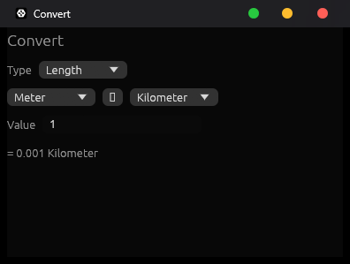
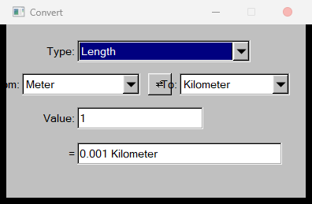
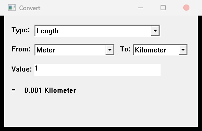

# Convert

> [!NOTE]
> This project was made by **not6741** with the help of **DeepSeek**, written in **Rust**.
> It uses the **MIT license** and is **fully FOSS** (free and open-source software).

The same unit converter, built **three times in Rust** — once per GUI toolkit — to show how
the size of a native desktop app changes with the framework you choose. Same features, same
math, wildly different footprints.

| Version | GUI toolkit | Release size | Platform | Notes |
|---|---|---|---|---|
| [`egui/`](egui) | `eframe` / `egui` | **4.46 MB** | Windows · macOS · Linux | Immediate-mode, modern look |
| [`fltk/`](fltk) | `fltk-rs` | **2.01 MB** | Windows · macOS · Linux | Native widgets, old-school look |
| [`win32/`](win32) | raw Win32 API | **0.16 MB** | Windows only | No GUI framework at all |

> All three share the exact same conversion logic and expression evaluator, which live in a
> single [`core/`](core) crate — so there is one place to fix bugs and one test suite.

> [!WARNING]
> **The `win32/` version is ultra-experimental.** It exists purely to demonstrate what is
> *technically possible* in terms of binary size — **not** as a serious or maintainable
> application. It is Windows-only, written directly against the raw Win32 API with `unsafe`,
> and has received no hardening, no accessibility work, and no real testing beyond "it opens".
> **Do not take it seriously for its capability or reliability, and do not use it in
> production.** It is intended **for research and investigation by developers only.**

## Screenshots

The same app, three toolkits — identical features, wildly different footprints:

| egui · 4.46 MB | fltk · 2.01 MB | Win32 · 0.16 MB |
|---|---|---|
|  |  |  |

## Features

- Three categories: **Length**, **Weight**, **Temperature**.
- Category picker, two unit dropdowns, and a swap button (`⇄`).
- **Live conversion** — the result updates on every keystroke.
- The value box accepts **arithmetic expressions**, not just numbers: `2+3*4`,
  `(100-32)*5/9`, `sqrt(2)`, `pi*2`, `2^10`. Supports `+ - * / ^`, parentheses, unary minus,
  the functions `sqrt abs sin cos tan ln log exp floor ceil round`, and the constants `pi`/`e`.
- Results are trimmed of trailing zeros (`1000.000000` shows as `1000`).

## Repository layout

```
core/   shared library: conversion logic + expression evaluator (with tests)
egui/   egui front-end   -> target/release/convert.exe
fltk/   fltk front-end   -> target/release/convert-fltk.exe
win32/  Win32 front-end  -> target/release/convert-win32.exe
```

## Building

You need [Rust](https://rustup.rs/). Then, from the repository root:

```sh
cargo build --release -p convert        # egui  version
cargo build --release -p convert-fltk   # fltk  version
cargo build --release -p convert-win32  # win32 version
```

Binaries are written to `target/release/`.

Extra requirements:

- **fltk** needs **CMake** and a **C++ toolchain** at build time (it compiles the FLTK C++
  library). On Windows, the Visual Studio C++ build tools are enough.
- **win32** needs nothing beyond Rust, but only builds/runs on Windows.

## Tests

```sh
cargo test
```

Covers length, weight, and temperature conversions, the identity case, number formatting, and
the full arithmetic expression evaluator (precedence, associativity, functions, constants,
and malformed input).

## How it works

Most categories use a **convert-via-base-unit** approach: every unit is defined by how large
it is relative to the category's base unit (metre for length, gram for weight), so converting
reduces to `value * factor(from) / factor(to)`. Temperature is the special case — it has
offsets as well as scale, so it funnels through Celsius instead.

Whatever you type is first run through the expression evaluator in
[`core/src/math.rs`](core/src/math.rs); a plain number like `42` is just a trivial expression.

The three front-ends are deliberately thin: they only wire widgets to the shared `core` API,
which is what makes them easy to compare.

## License

MIT — see [LICENSE](LICENSE).
