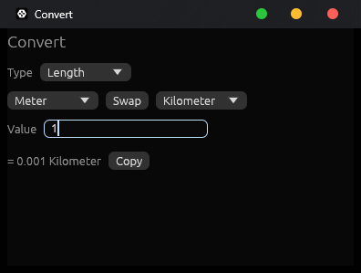

# Convert

[](https://github.com/not6741lol/unit-converter/actions/workflows/ci.yml)

> [!NOTE]
> This project was made by **not6741** with the help of **DeepSeek**, written in **Rust**.
> It uses the **MIT license** and is **fully FOSS** (free and open-source software).

The same unit converter, built **three times in Rust** — once per GUI toolkit — to show how
the size of a native desktop app changes with the framework you choose. Same features, same
math, wildly different footprints. (The egui build is also compiled to **WebAssembly** for a
browser demo.)

**▶️ Live demo — running in your browser (WASM):** <https://not6741lol.github.io/unit-converter/>



| Version | GUI toolkit | Release size | Platform | Notes |
|---|---|---|---|---|
| [`egui/`](egui) | `eframe` / `egui` | **4.5 MB** | Windows · macOS · Linux | Immediate-mode, modern look |
| [`fltk/`](fltk) | `fltk-rs` | **2.2 MB** | Windows · macOS · Linux | Native widgets, old-school look |
| [`win32/`](win32) | raw Win32 API | **0.19 MB** | Windows only | No GUI framework at all |

> All of them share the exact same conversion logic, expression evaluator and UI behaviour,
> which live in a single [`core/`](core) crate — so there is one place to fix bugs and one
> test suite.

> [!WARNING]
> **The `win32/` version is ultra-experimental.** It exists purely to demonstrate what is
> *technically possible* in terms of binary size — **not** as a serious or maintainable
> application. It is Windows-only, written directly against the raw Win32 API with `unsafe`,
> and has received no hardening, no accessibility work, and no real testing beyond "it opens".
> **Do not take it seriously for its capability or reliability, and do not use it in
> production.** It is intended **for research and investigation by developers only.**

## Screenshots

The same app, three toolkits — identical features, wildly different footprints:

| egui · 4.5 MB | fltk · 2.2 MB | Win32 · 0.19 MB |
|---|---|---|
|  |  |  |

## Features

- **16 categories:** Length, Area, Volume, Weight, Speed, Acceleration, Time, Frequency,
  Temperature, Pressure, Energy, Power, Force, Angle, Illuminance, and Data — with a couple of
  hundred units in total.
- **Calculator mode:** the whole app also works as a plain calculator, with no units at all —
  type `1 + 1` and get `2`.
- **Live conversion** — the result updates on every keystroke.
- **Search box** to filter the category list.
- **History and favourites** — save a conversion with one click, then click it to bring it
  back.
- **Number format** — automatic, a fixed number of decimals (0–6), or scientific notation.
- **Light / dark theme** (egui, fltk and web; the Win32 build follows the system theme).
- **Swap** and **Copy** (puts the result on the clipboard).
- The value box accepts **arithmetic expressions**, not just numbers:

  | | |
  |---|---|
  | Operators | `+ - * / % ^` and parentheses (`^` is right-associative) |
  | Functions | `sqrt cbrt abs sign sin cos tan asin acos atan sinh cosh tanh asinh acosh atanh ln log log2 exp exp2 floor ceil round trunc fract deg rad recip` |
  | Constants | `pi`, `tau`, `e`, `phi` |

  So `2+3*4`, `(100-32)*5/9`, `sqrt(2)`, `2^10`, `50%7`, `sin(pi/2)` and `12/log2(8)` all work.
- Results are trimmed of trailing zeros (`1000.000000` shows as `1000`), and very large or
  very small numbers switch to scientific notation automatically.
- **Runs in the browser too** — the same egui UI compiles to WebAssembly (see the live demo
  above).

## Repository layout

```
core/   shared library: conversion logic, expression evaluator, and the egui UI (with tests)
egui/   egui front-end   -> target/release/convert.exe
fltk/   fltk front-end   -> target/release/convert-fltk.exe
win32/  Win32 front-end  -> target/release/convert-win32.exe
web/    WASM front-end   -> deployed to GitHub Pages (see web/build.ps1)
```

## Building

You need [Rust](https://rustup.rs/). Then, from the repository root:

```sh
cargo build --release -p convert        # egui  version
cargo build --release -p convert-fltk   # fltk  version
cargo build --release -p convert-win32  # win32 version
```

Binaries are written to `target/release/`.

Web (WASM) build:

```sh
rustup target add wasm32-unknown-unknown
cargo install wasm-bindgen-cli --version 0.2.129
cargo build --release --target wasm32-unknown-unknown -p convert-web
wasm-bindgen --target web --out-dir web/dist --out-name convert_web \
  target/wasm32-unknown-unknown/release/convert_web.wasm
cp web/index.html web/dist/index.html   # then serve web/dist/

# Optional: shrink the .wasm (~9%) with Binaryen's wasm-opt:
wasm-opt --enable-bulk-memory --enable-bulk-memory-opt \
  --enable-nontrapping-float-to-int --enable-reference-types \
  --enable-mutable-globals \
  -Oz web/dist/convert_web_bg.wasm -o web/dist/convert_web_bg.wasm
```

On Windows you can just run `web/build.ps1` (it also runs `wasm-opt` when available).

Extra requirements:

- **fltk** needs **CMake** and a **C++ toolchain** at build time (it compiles the FLTK C++
  library). On Windows, the Visual Studio C++ build tools are enough.
- **win32** needs nothing beyond Rust, but only builds/runs on Windows.
- **web** needs the `wasm32-unknown-unknown` target and `wasm-bindgen-cli` (see above).
  Binaryen's `wasm-opt` is optional but recommended — it shaves ~9% off the `.wasm`.

## Tests

```sh
cargo test
```

Covers every category's conversions, the identity case, number formatting, the UI state
machine (modes, search, history, favourites), and the full arithmetic expression evaluator
(precedence, associativity, functions, constants, deeply nested input, and malformed input).

## How it works

Most categories use a **convert-via-base-unit** approach: every unit is defined by how large
it is relative to the category's base unit (metre, square metre, litre, gram, metre/second,
second, byte, pascal, joule, watt, newton, radian, lux, …), so converting reduces to
`value * factor(from) / factor(to)`. Temperature is the special case — it has offsets as well
as scale, so it funnels through Celsius instead.

Whatever you type is first run through the expression evaluator in
[`core/src/math.rs`](core/src/math.rs); a plain number like `42` is just a trivial expression.

All of the app's behaviour (modes, category search, history, favourites, clipboard text) lives
in [`core/src/app.rs`](core/src/app.rs), and the egui interface itself lives in
[`core/src/ui.rs`](core/src/ui.rs) — which is why the native egui build and the WebAssembly
build are byte-for-byte the same UI. The `fltk` and `win32` front-ends are deliberately thin:
they only wire their own widgets to that shared state.

## License

MIT — see [LICENSE](LICENSE).
